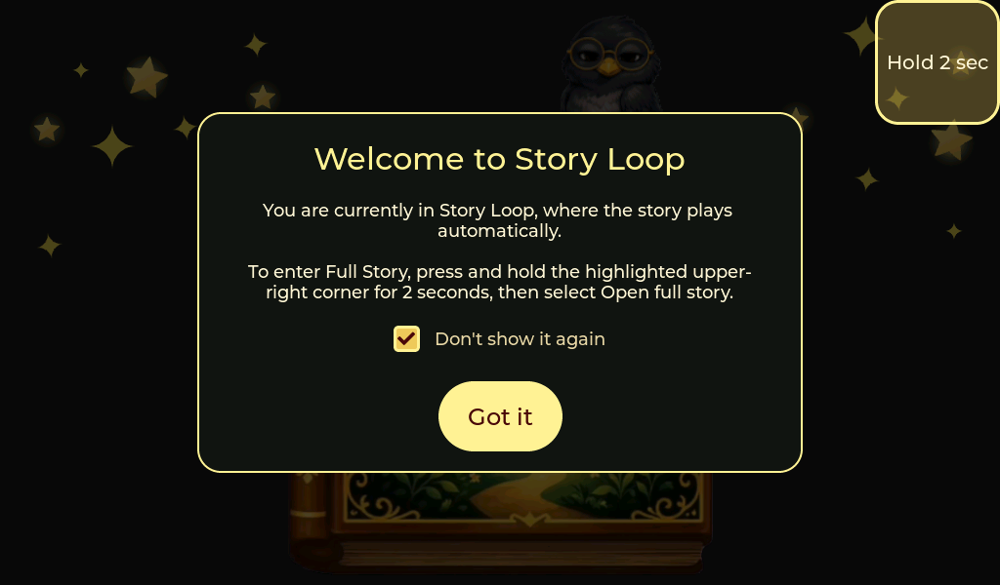
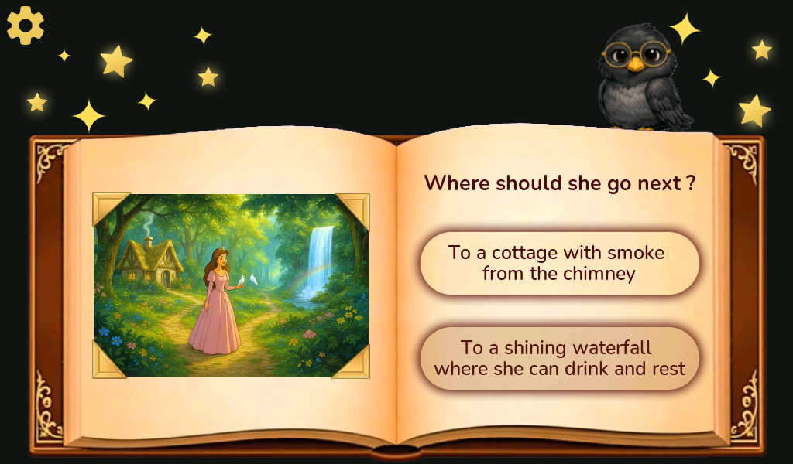

# Using the Storybook

## Switching Between Story Modes

The application starts automatically in **Story Loop** mode after the welcome screen.

To switch between **Story Loop** and **Full Story**:

1. Press and hold the **upper-right corner of the screen for about 2 seconds**.
2. Select the option for the mode you want to open:
   - In Story Loop, select **Open full story**.
   - In Full Story, select **Return to story loop**.
3. The application returns to the welcome screen and starts in the selected mode.

Select **Cancel** to keep using the current mode.

## Story Loop

Story Loop is an automatic demonstration mode. Narration, animations, and scene transitions run without user input.

When the choice screen appears:

1. You have **10 seconds** to select an option manually.
2. If no option is selected, the application makes the choice automatically.
3. The automatic choices alternate in this order:
   - **Play again**
   - **Finish story**
4. After **Finish story**, the ending sequence is played and the **Restart story** cloud appears. You then have **5 seconds** to tap the cloud and restart the story manually. If you do not tap it, the story restarts automatically and the application returns to the welcome screen.

## Full Story

In Full Story mode, the story waits for your input at each choice screen.

The current firmware contains **one fully available story branch**. Because the remaining branches are not yet available, only the active choice can be selected; the other choices are displayed as **disabled**.

Tap the available choice to continue to the next narrated scene.

At the end of the story, tap the **Restart story** cloud to return to the welcome screen and start again.

## Settings

Tap the **Settings** button during the story to open the settings screen.

You can adjust:

- **Volume**
- **Display brightness**

Opening Settings pauses the current story flow. Close Settings to continue from the same stage.
